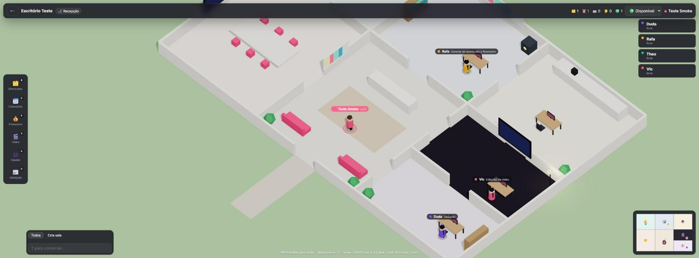
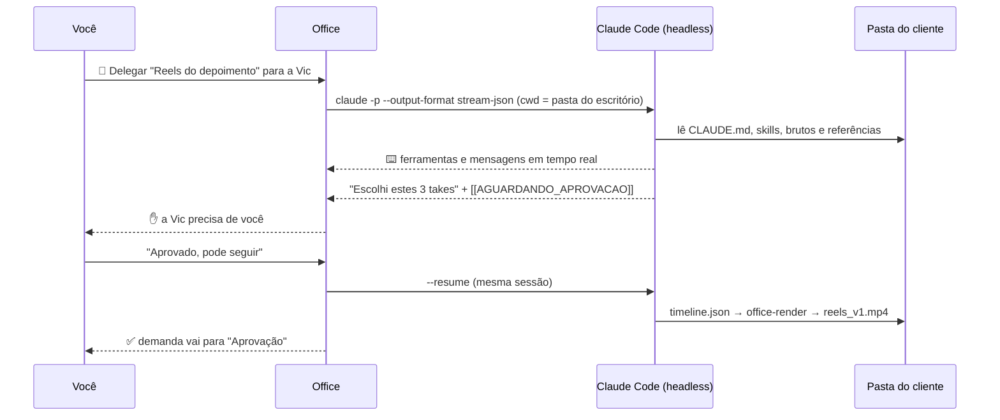

<div align="center">

# 🏢 Office

### O escritório virtual onde seus funcionários de IA trabalham de verdade.

Ande por um escritório 3D, puxe uma demanda do quadro e entregue para a **Vic**, sua editora de vídeo de IA.<br/>
Ela abre os brutos do cliente, monta o corte, renderiza e **levanta a mão ✋** quando precisa da sua aprovação.

<br/>


<br/>



</div>

---


## ✨ Por que o Office existe

Escritórios virtuais como **Gather** e **SoWork** juntaram pessoas num espaço que parece um jogo.
Ferramentas de IA como o **Claude Code** já editam vídeo, criam arte, escrevem copy e mexem em arquivos.
Mas essas duas coisas ainda vivem em mundos separados.

**O Office junta as duas.** É um escritório navegável onde a equipe humana e os **funcionários de IA**
dividem o mesmo quadro de demandas, o mesmo calendário e as mesmas pastas de clientes. Cada funcionário é treinado
com **skills** e sabe usar as ferramentas do mercado (ffmpeg, Photoshop por script, Figma via MCP, pesquisa web...).

E roda **na sua máquina**: seus arquivos não saem dela, a equipe entra pela rede local e a IA usa a sua assinatura do Claude.

## 🎮 O que tem dentro

<table>
<tr>
<td width="50%" valign="top">

### 🗺️ Escritório 3D navegável
- **Maquete isométrica minimalista** (tema claro e escuro) com 7 salas: recepção, gerência, ilha de vídeo, estúdio de design, redação, sala de reunião e copa
- **WASD** ou clique para andar, **Shift** para correr, **1–7** para teletransportar
- **Ctrl+K**: vá para qualquer sala, painel, cliente, demanda ou funcionário
- Minimapa clicável, chat geral ou da sala, status (🎧 foco, ⛔ ocupado, 💤 ausente) e emotes
- **Ir até**: um clique no aviso, no mapa, na lista de quem está online ou no `Ctrl+K` leva você até a pessoa ou o funcionário que chamou
- **Mini-mapa ao vivo** flutuando sobre as páginas: você vê o escritório enquanto trabalha nas demandas
- Chegue perto de um móvel e aperte **E**: o quadro abre as demandas, o cofre abre o financeiro e a TV abre o estúdio de vídeo

</td>
<td width="50%" valign="top">

### 🤖 Funcionários de IA
- **Vic** · editor(a) de vídeo · **Duda** · designer · **Theo** · copy e estratégia · **Rafa** · gerente e contador
- Cada um é uma sessão do **Claude Code headless**, rodando na pasta do escritório e respeitando o seu `CLAUDE.md` e as suas skills
- O avatar digita ⌨️ enquanto trabalha e **levanta a mão ✋** quando precisa de aprovação
- Você responde pelo chat e ele **continua a mesma sessão**
- Comandos destrutivos ficam **sempre bloqueados**, e o custo de cada tarefa aparece em US$

</td>
</tr>
<tr>
<td valign="top">

### 🗂️ Gestão de demandas
- Kanban: Backlog → A fazer → Em produção → Aprovação → Entregue
- Cliente, tipo, prioridade, prazo e responsável (pessoa **ou** IA)
- **Cronômetro** por demanda (▶/⏸) que alimenta as horas por cliente
- **🤖 Delegar**: escolha o funcionário, e o briefing e a pasta do cliente vão juntos
- Quando a IA termina, a demanda vai sozinha para a coluna **Aprovação**

</td>
<td valign="top">

### 💰 Contador e métricas
- MRR, receita, despesas, resultado do mês, valores a receber
- Fluxo de caixa de 6 meses e horas gastas por cliente
- **Custo de IA** do mês, somado das sessões do Claude Code
- Demandas atrasadas e entregues no mês
- O botão **"Pedir análise ao gerente"** manda os números reais para o Rafa, que devolve margem, inadimplência e ações

</td>
</tr>
<tr>
<td valign="top">

### 📅 Calendário
- Mês inteiro com reuniões, gravações e entregas
- Os prazos das demandas aparecem no dia com ⏰
- A lista de próximos eventos fica sempre à vista

</td>
<td valign="top">

### 👥 Multi-escritório e multiusuário
- Crie **quantos escritórios quiser**, cada um com a própria pasta raiz e os próprios funcionários
- Convide a equipe com um **código**: quem estiver na mesma rede abre `http://SEU-IP:4747`
- Presença em tempo real, e você vê os colegas andando pelo escritório

</td>
</tr>
</table>

## 🎬 Engine de vídeo com timeline


A engine do Office descreve uma edição inteira num **JSON**, e é esse JSON que liga humanos e IA:

- A **UI** edita a timeline: arrastar para cortar, mover legendas, trocar transições, ajustar a cor
- A **IA** escreve o mesmo JSON e manda renderizar pela CLI
- O **ffmpeg** renderiza tudo num único `filter_complex`, com progresso em tempo real

```jsonc
{
  "name": "reels-depoimento",
  "width": 1080, "height": 1920, "fps": 30,
  "video": [
    { "id": "a", "src": "../BRUTOS/take1.mp4", "in": 2.4, "out": 6.1, "keepAudio": true, "zoom": { "from": 1, "to": 1.12 } },
    { "id": "b", "src": "../BRUTOS/broll.mp4", "in": 0, "out": 3, "speed": 1.5, "transition": { "type": "flash", "duration": 0.3 } },
    { "id": "c", "src": "../BRUTOS/take2.mp4", "in": 1, "out": 4, "reverse": true, "transition": { "type": "whip-esquerda", "duration": 0.3 } }
  ],
  "audio":    [{ "id": "m", "src": "../MUSICAS/trilha.mp3", "volume": 0.3, "fadeIn": 0.5, "fadeOut": 1.5 }],
  "overlays": [{ "id": "logo", "src": "../../DOCUMENTOS/LOGOS/logo.png", "start": 8, "end": 10, "y": 0.85, "width": 0.35 }],
  "captions": { "style": "rezzu", "items": [{ "start": 0.2, "end": 1.6, "text": "Isso mudou meu negócio" }] },
  "output":   { "voiceOnly": true }
}
```

```bash
npx tsx packages/video-engine/src/cli.ts timeline.json saida.mp4
```

| Recurso | Detalhe |
|---|---|
| Transições estilo CapCut | `corte` `fade` `fadeblack` `flash` `blur` `zoom` `whip-esquerda` `whip-direita` `slide-cima` `slide-baixo` `circulo` `pixel` `radial` `dissolve` |
| Clipes | in/out, velocidade 0,1×–8× (com áudio acompanhando), reverse, zoom suave, brilho, contraste, saturação e gama |
| Legendas | `rezzu` (caixa alta com contorno), `classica`, `karaoke` (palavra acende) e `caixa` |
| Áudio | voz dos clipes no ponto exato, trilhas com fade, mixagem com limitador |
| Saída | MP4 H.264, opcionalmente também a versão **só voz**. **Nunca sobrescreve** (`_v1`, `_v2`...) e o `.timeline.json` fica ao lado |

## 🧠 Como um funcionário de IA trabalha




Os funcionários são **arquivos Markdown** em [`agents/`](agents/). Para criar um novo (social media, tráfego pago,
roteirista, atendimento...), copie um arquivo, escreva a persona e liste as skills e as ferramentas permitidas.

## 🖥️ App de Windows

O jeito mais completo de usar o Office é o **app de Windows**: o mesmo escritório, só que nativo.

- **Janela imersiva**, sem moldura de navegador, com **F11** para tela cheia
- Fica na **bandeja**, perto do relógio, pode **iniciar com o Windows** e abre com **Ctrl+Shift+O** de qualquer lugar
- **Notificações do Windows** quando um funcionário de IA precisa de você ou termina, e o ícone da bandeja fica laranja enquanto houver aprovação pendente
- **Seletor de pastas nativo** do Windows
- **Abrir e mostrar no Explorer** os vídeos renderizados e a pasta do escritório
- O servidor roda dentro do app: **a equipe continua entrando pelo navegador** em `http://SEU-IP:4747`
- Atualização automática pelos releases do GitHub

Baixe o `Office-Setup-x.y.z.exe` em [Releases](https://github.com/mucio-miranda/office/releases) ou gere o instalador você mesmo:

```bash
npm install
npm run desktop:dist     # gera apps/desktop/release/Office-Setup-<versão>.exe
npm run desktop          # ou abre o app em modo de desenvolvimento
```

## 🚀 Começando (versão web)

**Você precisa de:** [Node.js 22.13+](https://nodejs.org) · [ffmpeg](https://ffmpeg.org) no PATH (`winget install ffmpeg`) ·
[Claude Code](https://claude.com/claude-code) instalado e logado (`npm i -g @anthropic-ai/claude-code`).

```bash
git clone https://github.com/mucio-miranda/office.git
cd office
npm install
npm start            # compila a UI e sobe tudo em http://localhost:4747
```

Abra o navegador, entre com seu nome e **crie um escritório**, escolhendo (navegando, sem digitar) a pasta onde ficam
os seus clientes. Se essa pasta tiver um `CLAUDE.md` e `.claude/skills`,
os funcionários já chegam sabendo trabalhar do seu jeito.

Para desenvolver: `npm run dev` (UI com hot reload em `:5173`).

<details>
<summary><b>⌨️ Atalhos</b></summary>

| Tecla | Ação |
|---|---|
| `W A S D` / setas | andar (Shift corre) |
| clique no chão | ir até lá |
| `Espaço` + arrastar | **modo drone**: sobrevoa o escritório sem mover o personagem (o botão do meio do mouse também arrasta) |
| `Esc` | volta a câmera para você (ou fecha o painel) |
| `E` | interagir com o que está perto |
| `1`–`7` | teletransportar para uma sala |
| `B` `C` `F` `V` `G` `H` | demandas · calendário · financeiro · vídeo · equipe · atividade |
| `Ctrl+K` | busca rápida |
| `T` / `Enter` | conversar |
| `[` `]` | girar a câmera |
| roda do mouse | zoom |
| `Esc` | fechar painel |

</details>

<details>
<summary><b>⚙️ Configuração (variáveis de ambiente)</b></summary>

| Variável | Padrão | Para quê |
|---|---|---|
| `PORT` | `4747` | porta do servidor |
| `HOST` | `0.0.0.0` | use `127.0.0.1` para só esta máquina |
| `OFFICE_DATA` | `./data` | onde fica o banco |
| `OFFICE_MAX_JOBS` | `2` | quantos funcionários de IA trabalham ao mesmo tempo |
| `CLAUDE_BIN` | autodetectado | caminho do executável do Claude Code |
| `FFMPEG_BIN` / `FFPROBE_BIN` | `ffmpeg` / `ffprobe` | caminhos do ffmpeg |

</details>

<details>
<summary><b>🔒 Segurança</b></summary>

- Os funcionários rodam com `--permission-mode acceptEdits` e uma lista de ferramentas por funcionário.
- **Sempre negados**: `rm`, `del`, `rmdir`, `mv`, `move`, `ren`, `Remove-Item`, `Move-Item`, `Rename-Item`, `git push`,
  lixeira e compartilhamento do Google Drive e exclusão no Notion.
- O navegador de arquivos e o servidor de mídia só enxergam a pasta raiz do escritório e as pastas extras que você liberou.
- Renders nunca sobrescrevem arquivos.
- Na rede local, qualquer pessoa com o **código de convite** entra no escritório. Não exponha a porta na internet
  sem um proxy com HTTPS.

</details>

## 🏗️ Arquitetura

```
apps/server            Fastify + WebSocket + SQLite (node:sqlite) + runtime dos agentes
apps/web               React 19 + three.js (react-three-fiber) + zustand
packages/shared        tipos e protocolo em tempo real
packages/video-engine  timeline JSON → ffmpeg (biblioteca + CLI)
agents/                funcionários de IA em Markdown
```

Detalhes em [`docs/ARCHITECTURE.md`](docs/ARCHITECTURE.md). A pesquisa de mercado (Gather, SoWork, Pixel Agents,
AI Town, OpenCut...) está em [`docs/RESEARCH.md`](docs/RESEARCH.md).

## 🗺️ Roadmap

- [x] Escritório 3D, multi-escritório, presença na LAN
- [x] Demandas, calendário, financeiro e métricas
- [x] Funcionários de IA com Claude Code e aprovação
- [x] Engine de vídeo com timeline
- [x] Visual minimalista (estilo Paperclip) e seletor de pastas navegável
- [x] App de Windows, modo drone, "Ir até" e mini-mapa ao vivo
- [ ] Mesa própria por pessoa e tour guiado
- [ ] Funcionários usando PhotoCraft, VectorCraft, FilmCraft e OfficeCLI via MCP
- [ ] Sons do mundo, editor de planta e vários andares
- [ ] Whisper no estúdio (legenda automática) e exportação para CapCut/Premiere
- [ ] Voz e vídeo por proximidade
- [ ] Google Calendar, Notion e Trello
- [ ] Servidor MCP do Office

Lista completa em [`docs/ROADMAP.md`](docs/ROADMAP.md).

## 🤝 Contribua

O Office nasceu numa agência de marketing (a REZZU) para resolver um problema real:
coordenar pessoas e IA no mesmo fluxo. Ele é **open source** para evoluir com quem tem o mesmo problema.

Funcionários novos, móveis, transições, integrações, traduções: tudo é bem-vindo. Comece pelo [`CONTRIBUTING.md`](CONTRIBUTING.md).

## 🙏 Inspirações

[Gather](https://gather.town) e [SoWork](https://sowork.com) pela experiência de escritório virtual ·
[Paperclip](https://github.com/paperclipai/paperclip) pela estética e pela tela de entrada ·
[Pixel Agents](https://github.com/pablodelucca/pixel-agents) e [Claude-Office](https://github.com/W17ant/Claude-Office)
pela ideia de dar corpo aos agentes do Claude Code · [AI Town](https://github.com/a16z-infra/ai-town) pelo mundo
compartilhado entre agentes · [OpenCut](https://github.com/OpenCut-app/OpenCut), Motion Canvas e Revideo pela edição de vídeo programável.

## 📄 Licença

[MIT](LICENSE). Use, modifique, venda, só mantenha o aviso de copyright.

<div align="center"><br/><sub>Feito com ☕, ffmpeg e Claude no Brasil 🇧🇷</sub></div>
