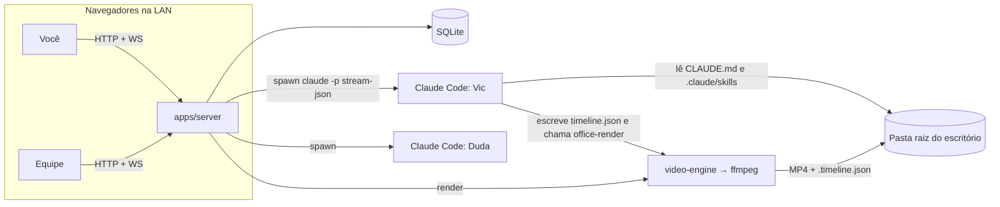

# Arquitetura

```
office/
├── apps/
│   ├── server/          Fastify + WebSocket + SQLite (node:sqlite) + runtime dos agentes
│   └── web/             React 19 + three.js (react-three-fiber) + zustand
├── packages/
│   ├── shared/          tipos e protocolo do WebSocket
│   └── video-engine/    timeline JSON → ffmpeg (biblioteca + CLI `office-render`)
├── agents/              modelos de funcionários de IA (Markdown com frontmatter)
└── data/                banco e logs dos jobs (fora do git)
```

## Visão geral



## Servidor (`apps/server`)

- **Um processo só**: API REST em `/api`, WebSocket em `/ws` e, em produção, a UI estática de `apps/web/dist`.
- **Banco**: `node:sqlite` (sem dependência nativa para compilar). Migrações em `db.ts`. Colunas JSON são
  serializadas automaticamente e os nomes snake_case viram camelCase.
- **Autenticação**: nome + PIN opcional (scrypt). O token vai no `Authorization: Bearer` e também num cookie
  httpOnly (para `<video>` conseguir buscar mídia). Todo acesso a escritório confere o vínculo de membro.
- **Arquivos**: `/fs`, `/media` e `/probe` só enxergam a pasta raiz do escritório e as pastas extras.
  `/media` suporta `Range` (pular no tempo do vídeo).
- **Tempo real** (`realtime.ts`): presença (posição, direção, sala, status), chat por sala ou geral, emotes
  e `invalidate` para a UI recarregar coleções quando o banco muda.

## Funcionários de IA (`apps/server/src/agents`)

1. Modelos em `agents/*.md` são copiados para o banco quando o escritório é criado (`seedAgents`).
2. `enqueueJob` grava o job e entra numa fila com limite de concorrência (`OFFICE_MAX_JOBS`, padrão 2).
3. `start` monta o prompt de sistema (persona + `_regras-da-casa.md` + skills) num arquivo e roda:
   ```
   claude.exe -p --output-format stream-json --verbose
     --append-system-prompt-file <job>/system.md
     --permission-mode acceptEdits
     --allowedTools <do modelo>  --disallowedTools <lista fixa de destrutivos>
     [--add-dir <pastas extras>] [--resume <session_id>]
   ```
   com `cwd` = pasta raiz do escritório e o prompt no **stdin** (sem problemas de aspas no Windows).
4. Cada linha do `stream-json` vira mensagem: o texto do agente, um resumo de cada ferramenta usada e o custo.
5. Se a resposta final contém `[[AGUARDANDO_APROVACAO]]`, o job fica `aguardando` e o avatar levanta a mão ✋.
   A resposta humana roda `--resume` na **mesma sessão**.
6. Concluído com demanda ligada: a demanda vai para a coluna **Aprovação**.

**Segurança**: comandos de apagar, mover e renomear, `git push` e as ferramentas de lixeira e compartilhamento do
Drive estão sempre negados, seja qual for o modelo. O `CLAUDE.md` da pasta raiz continua valendo.

## Engine de vídeo (`packages/video-engine`)

- `schema.ts`: o formato da timeline (zod). Clipes com in/out, velocidade, reverse, zoom (Ken Burns), cor,
  áudio próprio e transição de entrada. Também trilhas de áudio com fade, sobreposições (logo) e legendas com 4 estilos.
- `compile.ts`: **função pura** que transforma a timeline num comando ffmpeg com um único `filter_complex`.
  - Cada clipe é normalizado (tamanho, fps, SAR, pixel format, timebase) para o `xfade` funcionar.
  - Transições: `xfade` com `offset` calculado por `layout()`. O corte usa `concat`.
  - O áudio de cada clipe entra com `adelay` no ponto exato da timeline. Depois tudo passa por `amix` e `alimiter`.
  - As legendas viram um arquivo `.ass` queimado com `subtitles` (rodando com `cwd` na pasta temporária, o que
    evita o pesadelo de escapar caminhos do Windows dentro do filtro).
  - Opcional: segunda saída `_so-voz.mp4` (mesma imagem, só a voz).
- `render.ts`: `ffprobe` das fontes, validação, execução com `-progress pipe:1` e progresso em tempo real.
- Saídas **nunca sobrescrevem**: `nome_v1.mp4`, `nome_v2.mp4`... e o `.timeline.json` fica ao lado.

Lição registrada: `zoompan` seguido de `xfade` travava o ffmpeg (197 s para 3,6 s de vídeo). Regenerar os
timestamps com `setpts=N/FPS/TB` depois do `zoompan` resolve (1,4 s). Há teste cobrindo isso.

## App de Windows (`apps/desktop`)

Electron 45 (Node 24 embutido, com `node:sqlite`). Nada do servidor foi reescrito:

- `scripts/build.mjs` empacota com esbuild o **servidor inteiro** (`server.mjs`), a **CLI da engine**
  (`office-render.mjs`), o processo principal e o preload, e copia a UI, os modelos de funcionários e os ícones.
- `src/main.ts`:
  - Sobe o servidor num `utilityProcess`, isolado da janela. Se já existe um Office na porta 4747 (`/api/health`), apenas se conecta a ele.
  - Usa a mesma pasta `data/` do repositório em desenvolvimento e `%APPDATA%/Office/data` quando instalado.
  - Cria o atalho `office-render` (bash e .cmd) que roda a CLI com o próprio `Office.exe` em modo Node (`ELECTRON_RUN_AS_NODE`) e o põe no `PATH` dos funcionários.
  - Janela com barra de título embutida (`titleBarOverlay` de 56 px, a mesma altura do cabeçalho), bandeja, atalho global, notificações, `flashFrame`, iniciar com o Windows e electron-updater.
- `src/preload.ts` expõe `window.officeDesktop` com `contextIsolation` e `sandbox`. A UI checa se ele existe e, se não existir, cai no comportamento web.
- `electron-builder` gera o instalador NSIS e publica nos releases do GitHub (`npm run release -w @office/desktop`).

Nota de segurança: o fuse `RunAsNode` precisa ficar ligado para o `office-render` funcionar sem Node instalado.
Quem quiser endurecer o binário pode desligá-lo e apontar `OFFICE_RENDER_CMD` para um Node do sistema.

## UI (`apps/web`)

- `office/layout.ts`: planta (salas, paredes com portas, móveis, mesas dos agentes) e colisão com deslizamento.
- `office/World.tsx`: cena, jogador (WASD, clique para andar, Shift para correr), câmera isométrica que segue
  o jogador, avatares remotos interpolados e funcionários sentados.
- `office/Labels.tsx`: nomes e balões em DOM, projetados num único `useFrame`.
- `OfficeView.tsx`: HUD (contadores), dock, minimapa clicável (teleporte), chat, paleta `Ctrl+K` e atalhos.
- `panels/`: Demandas (kanban com cronômetro e delegação para IA), Calendário, Financeiro, Funcionário de IA,
  Estúdio de vídeo (timeline), Equipe e Atividade.
